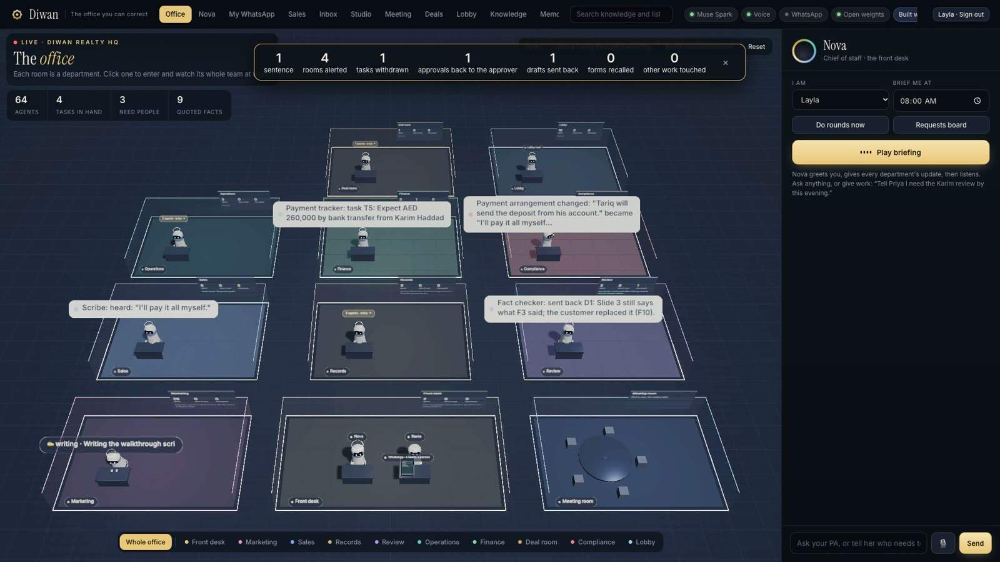
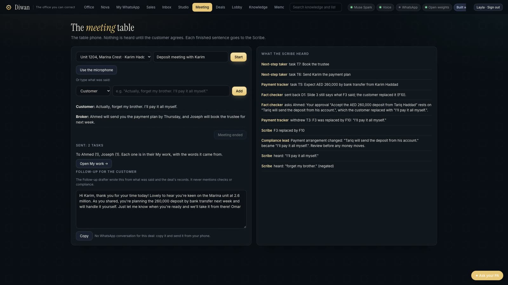

<div align="center">

# Diwan

**The back office you can correct.**

An AI-run back office for real-estate brokerages, where every action traces back to what the client actually said.



<sub>Meta Global AI Developer Hackathon · Built with Muse Spark, Muse Spark Open, Muse Voice Transcribe and Muse Image</sub>

</div>

---

## Try it

**Live demo: https://diwan-kxp4.onrender.com** · a fictional office (names, units, prices and permit numbers are made
up). It runs on a free server: the first visit after a quiet spell can take about a minute to wake, and the office starts
fresh each time it does.

Sign in by name. The passwords are in the submission notes.

| Sign in as | To see |
|---|---|
| `layla` (the owner) | The whole office, Nova her assistant, every room |
| `omar` (a broker) | Only his own clients and calendar; nothing from Compliance |
| `priya` (Compliance) | Screening, source-of-funds work and the reasons, which nobody else sees |
| `maya` (Marketing) | The Studio: scripts waiting, the week's plan, a post paused by a price change |

**Four steps, as Layla:**
1. **Office** shows the day already in motion: clients on WhatsApp, viewings booked, work waiting in every room.
2. **Meeting**: pick *Unit 1204, Marina Crest · Karim Haddad*, press Start, then *The customer agrees*. Type the broker's
   line, then Karim's: *"Actually, forget my brother. I'll pay it all myself."* (Or press **Karim corrects himself** in
   the Office.)
3. Back in **Office**, watch the ripple: Compliance first, only the work that rested on the old words withdrawn,
   *0 other work touched*.
4. **Deals** shows the same counts under *Latest correction*. Ask **Nova**: *"Who is paying Karim's deposit?"*

**WhatsApp without a phone:** in **Inbox**, the **Sandbox phone** button lets you write in as a new client and watch
Rania, the receptionist agent, answer from the real listings. No real WhatsApp number is connected.

## Problem

A brokerage deal passes through many hands: the broker, Finance, Compliance, Operations and Marketing. Each team acts on what the client said, usually relayed through chat messages and meeting notes.

Clients change their minds, and when they do, the change rarely reaches everyone. Finance keeps expecting a payment from the wrong person. Documents carry outdated terms. Approvals given under the old arrangement remain valid. And Compliance, which anti-money-laundering rules require to be informed first, is often the last to know.

The cost is not just inefficiency. It's regulatory exposure, wrong money movements and lost client trust.

## Solution

Diwan records what clients say as **facts with their exact words**, and ties every piece of work to the facts it depends on. Agents built on Meta's Muse models handle the routine work, while people keep every decision that matters.

When a client corrects themselves, Diwan updates the office in one step:

- **Compliance is informed before anyone can act.**
- **Only the work that depended on the old statement is withdrawn;** everything else is left alone.
- **Approvals based on the old statement can no longer be used.**
- **The meeting ends with clear tasks,** each with an owner, a deadline and the source quote.

> *"Actually, forget my brother. I'll pay it all myself."*
>
> One sentence in a live meeting. Within seconds, Compliance is alerted, two dependent tasks are withdrawn, the payment approval returns to Finance for review, and an outdated slide is flagged. No other work is touched.



## What makes Diwan different

**Traceable by design.** Every answer, task and approval links to the client's own words. Agents can't state what the records don't support, and quotes are verified against their source.

**Corrections, not just automation.** Most AI tools automate a workflow forward. Diwan also handles the harder case: undoing precisely what a changed fact invalidates, and nothing more.

**Compliance built in, not bolted on.** Compliance is informed first, its reasoning stays confidential to protect against tipping off, and source-of-funds checks are argued from both sides on Meta's open-weight model before a person decides.

**Accountable agents.** Each of the 64 agents has a charter defining what it may do alone, what requires a person, and what it must never do. Agents prepare; people approve, sign and submit.

## Highlights

- **A live 3D office.** Ten department rooms with 64 agents at their desks. Work travels between rooms as it happens, and a correction plays out as a ripple with its real counts: rooms alerted, tasks withdrawn, approvals returned, and zero other work touched.
- **Every decision on the record.** An append-only log keeps every message, fact and decision; nothing is edited or deleted. The memory graph replays any deal's history step by step.
- **Hire an agent in one sentence.** The owner describes a new agent in plain words, and it joins the office with built-in limits: it can't message clients, change facts or move money.
- **Cost-aware.** Every model call is logged with its cost. A monthly cap stops spending when it's reached, and the agents fall back to plain rules, saying so.
- **Tested like a real office.** 1,367 automated tests, 35 browser flows that drive the real pages as each team member, and 40 kinds of client conversation read end to end.

## Capabilities

| Area | What it does |
|---|---|
| **Client intake** | An AI receptionist answers WhatsApp enquiries at any hour from real listings only, qualifies leads and schedules viewings for broker confirmation |
| **Meetings** | Consent-gated live transcription, with facts captured with speaker and quote, and commitments turned into tasks |
| **Coordination** | A personal assistant for every team member. The owner's assistant routes requests, and every answer cites its source |
| **Calendar** | Each assistant runs its person's calendar: what's on, who's free, meetings with colleagues on both calendars, and client calls, each with a real Zoom link. Nothing is booked without a yes |
| **Compliance** | Party screening, source-of-funds analysis, cash payments held for review, and role-based confidentiality |
| **Deal execution** | Approvals linked to facts, regulatory forms prepared up to submission, and invoices calculated from agreed terms |
| **Marketing** | Listing scripts scored by an AI creative director, film lists for brokers and a weekly content plan |
| **Improvement** | Weekly reports from each team, with controlled experiments tested on half the leads before being kept |

## Marketing Studio

The Marketing room works from the same records as the rest of the office, so a post can't say what the listing doesn't.

- **Scripts with a frame-by-frame plan.** Muse Spark writes three script options, in English and Arabic. Each comes
  with its shots (when, what's shown, the words on screen, the spoken line) and a visual brief per frame. A Creative
  Director scores every option, and a person picks one.
- **The right format for what exists.** A reel, a carousel, a single image or a designed graphic, chosen from the photos
  and footage the listing actually has.
- **Pictures, a voice-over or a video.** After a script is picked, the person chooses how it goes out, and one option
  is suggested with its reason. Pictures turn the script's own frames into a carousel: a listing's own photos, with the
  permit and the call to action last. A voice-over is the script read by the computer's voice over the frames. A video
  is filmed or made by the AI presenter. On a server that can't make video safely (`DIWAN_VIDEO=off`), only pictures
  are offered.
- **Pictures that look like the place.** A listing uses only its own photos. A topic post gets photographs drawn by
  Muse Image from a planned shot (place, camera, light, materials), with no text or logos inside the picture.
- **Brand and permit on every picture.** The company's logo and colours go on each slide, and a listing's advertising
  permit sits on every picture of it. A listing with no permit is never advertised.
- **A change of facts stops the post.** If a listing's price, status or permit changes after its script was approved,
  the post pauses with the reason ("The price was AED 1,900,000, now AED 1,950,000"). It resumes when the facts match
  again, and comes down if the unit is sold.
- **A plan for the week.** Posting days and the best time for each post, with Approve and Reschedule buttons.
  Nothing goes out without a person's yes. Each platform (Instagram, Facebook, LinkedIn, TikTok, YouTube Shorts,
  Property Finder) gets copy written in its own style.

## Built on Meta's models

| Model | Role in Diwan |
|---|---|
| **Muse Spark** | Client conversations, the assistants, fact extraction, meeting tasks, script writing and review. Calendar answers and bookings are read from the records by rules, so a time is never guessed |
| **Muse Spark Open** (via Baseten) | Source-of-funds analysis and the counter-argument, run on open weights |
| **Muse Voice Transcribe** | Live meeting transcription with speaker separation |
| **Muse Image** | Visual content for marketing |

## Status

| | |
|---|---|
| **Working** | All capabilities above, verified end to end in the browser, with 1,405 automated tests passing |
| **In progress** | A live WhatsApp connection (currently a sandbox), Google Meet links, calendar sync and full Arabic responses |

## Roadmap

- **Marketing next:** a scannable QR code on the last frame that opens WhatsApp with the listing's code; long YouTube
  walk-throughs with chapters; a LinkedIn investment card that shows a yield only when the office has recorded one;
  the photo director choosing shots with a clearer sense of place, and the best of two pictures for the opening frame;
  marketing that starts by itself when a listing goes live.
- **Meetings with guests:** a third voice in a meeting kept as a guest, whose words never become facts until someone
  says who they are, and a screen that hides internal notes while a client is in the call.
- **Off-plan in 3D:** upload a developer's floor plan; Meta's SAM 3.1 finds each room and Diwan builds a simple walkable
  3D unit, shared with overseas buyers during a call through a client-safe Diwan link. Room sizes always come from the
  developer's plan, never from the model.
- **Nova joins your call:** the owner's assistant as a participant in Zoom or Meet. She listens, answers when asked, and shares the deal or calendar on screen.
- **3D meeting room:** a live meeting shown in the office's meeting room, with commitments rising as cards as they're spoken.
- **Night replay:** the office's overnight work replayed on the 3D floor each morning.
- **Live channels:** a real WhatsApp line and Google or Outlook calendar sync.
- **Full Arabic** conversations, and UAE-hosted data for production.

## Getting started

```sh
git clone https://github.com/alifiya-saifee/diwan.git && cd diwan
python3 -m venv .venv && .venv/bin/pip install -r requirements.txt
cp .env.example .env    # add META_API_KEY, BASETEN_API_KEY and the Supabase keys
.venv/bin/uvicorn diwan.app:app --port 8030
```

Open http://localhost:8030. A demo office with fictional data is created on first launch.

## About

Built from scratch for the Meta Global AI Developer Hackathon, 27 October – 4 November 2026. Full product documentation is in [PROJECT.md](PROJECT.md). Released under the [MIT License](LICENSE).
